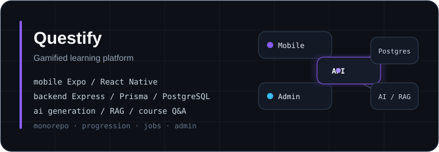
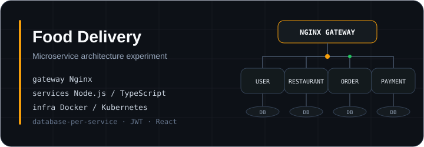

  

 

**Full-stack developer based in Cairo**

Working mostly with **TypeScript**, **React**, **Node.js**, **Laravel**, and **PostgreSQL**.  
Interested in backend architecture, system design, deployment, and practical AI-assisted development.

---

## About

I like building applications that are not just functional, but structured properly underneath — APIs, databases, architecture, deployment, and developer workflows.

A lot of what I care about sits somewhere between product engineering and systems thinking: building things that work, scale reasonably, and do not collapse the moment the happy path ends.

## Stack

  

 

## Selected Work

  
  

## GitHub

  

