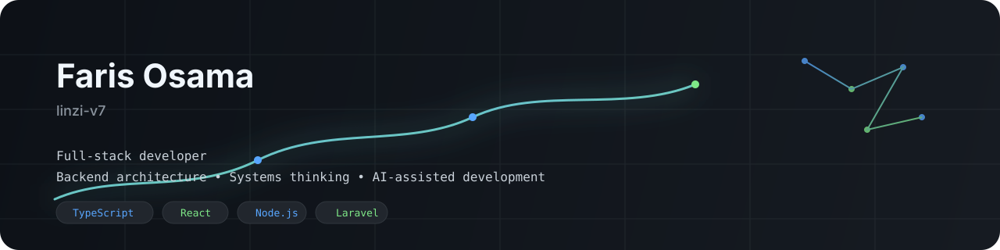

  

 

**Full-stack developer based in Cairo**

Working mostly with **TypeScript**, **React**, **Node.js**, **Laravel**, and **PostgreSQL**.  
Interested in backend architecture, system design, deployment, and practical AI-assisted development.

---

## About

I like building applications that are not just functional, but structured properly underneath — APIs, databases, architecture, deployment, and developer workflows.

A lot of what I care about sits somewhere between product engineering and systems thinking: building things that work, scale reasonably, and do not collapse the moment the happy path ends.

## Selected Work

<table>
<tr>
<td width="50%" valign="top">

### [Questify](https://github.com/linzi-v7/questify)

A gamified learning platform built as a full-stack monorepo.

**Includes**
- React Native / Expo mobile app
- React admin dashboard
- Express + Prisma backend
- PostgreSQL
- AI-generated educational content
- RAG-based course Q&A
- progression systems, achievements, jobs, storage, and leaderboards

</td>
<td width="50%" valign="top">

### [Food Delivery Platform](https://github.com/linzi-v7/food-delivery-project)

A distributed food delivery system built while exploring service-oriented architecture.

**Includes**
- Node.js / TypeScript microservices
- database-per-service PostgreSQL
- Nginx API gateway
- React frontend
- Docker Compose
- Kubernetes / Minikube
- JWT authentication and multi-service communication

</td>
</tr>
</table>

## Stack

  

## GitHub

  
  

## Activity

  

