<picture>
  <source media="(prefers-color-scheme: dark)" srcset="./assets/hero-dark.svg" />
  
</picture>

 

I am a full-stack engineer in Cairo. I design the data model, write the API, build the screens and run the deploy.

### Work

<a href="https://multaqa.site">
  <picture>
    <source media="(prefers-color-scheme: dark)" srcset="./assets/work-multaqa-dark.svg" />
    
  </picture>
</a>

<a href="https://github.com/linzi-v7/malaf-releases">
  <picture>
    <source media="(prefers-color-scheme: dark)" srcset="./assets/work-malaf-dark.svg" />
    
  </picture>
</a>

<a href="https://github.com/linzi-v7/questify">
  <picture>
    <source media="(prefers-color-scheme: dark)" srcset="./assets/work-questify-dark.svg" />
    
  </picture>
</a>

### Activity

<picture>
  <source media="(prefers-color-scheme: dark)" srcset="./assets/activity-dark.svg" />
  
</picture>

<picture>
  <source media="(prefers-color-scheme: dark)" srcset="./assets/life-dark.svg" />
  
</picture>

### Stack

<picture>
  <source media="(prefers-color-scheme: dark)" srcset="./assets/stack-dark.svg" />
  
</picture>
